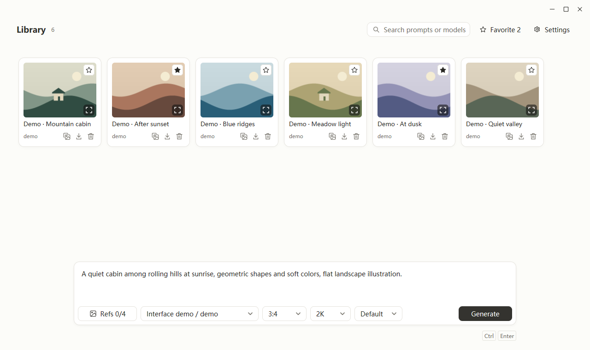

# Picloom · 绘织

**English** | [简体中文](README.zh-CN.md)

Picloom is a native AI image creation app for Windows and macOS, built with Go and MyGo. Connect your own OpenAI-compatible image service to generate images from prompts, reference images, or annotations, and organize your work locally.

[Download the latest release](https://github.com/JsoonLi/Picloom/releases/latest) · [All releases](https://github.com/JsoonLi/Picloom/releases) · [Report an issue](https://github.com/JsoonLi/Picloom/issues)



*English UI demo using local sample illustrations.*

## Download and install

Choose the installer for your platform from Releases:

| Platform | Installer |
| --- | --- |
| Windows x64 | `Picloom-Setup-<version>-x64.exe` |
| macOS Intel | `Picloom-<version>-macOS-x64.dmg` |
| macOS Apple Silicon | `Picloom-<version>-macOS-arm64.dmg` |

macOS 12.0 or later is required. The Updates tab in the app's settings lets you check for updates and configure automatic checks and downloads. Update packages are verified against their signatures.

## Get started

1. Open the app's settings and enter your service's Base URL and API Key in the Providers tab.
2. Fetch and enable image models, then select the resolutions your service supports. Settings save automatically.
3. Enter a prompt in the creation area, choose a model, aspect ratio, and output format, then start generating.
4. Add reference images for image-to-image generation. Results are saved in your local library, where you can preview, favorite, copy, or export them.

You need to supply your own image service and API key. Your service provider handles usage charges. Available models, resolutions, and output formats depend on the service you connect.

## Features

- **Text-to-image and reference images**: Add up to 4 reference images using the file picker, drag and drop, or clipboard. References support PNG, JPEG, and WebP, up to 20 MB each.
- **Batch processing**: Apply one prompt and aspect ratio to multiple images, add shared references, and manage each batch from a single library card with progress, results, and retries.
- **Annotation editing**: Mark areas on a single source image with a pen, rectangles, or circles, then describe the changes you want. The source image and annotation layer are preserved for further editing.
- **Output formats**: Choose PNG, JPEG, WebP, GIF, or SVG. GIF options include frame count, frame duration, and dimensions.
- **Image library**: Search by prompt or model, filter favorites, inspect generation settings, switch between results and references in the preview, and reuse prompts and settings.
- **Redo failed jobs**: Restore prompts, references, annotations, and generation settings to the creation area, edit them, and submit again.
- **Providers and networking**: Manage multiple image services, fetch model lists, set default resolutions, and use the system proxy, a direct connection, or a manual proxy.
- **Appearance and updates**: English and Simplified Chinese interfaces, light, dark, and system themes, plus in-app updates.

GIF, SVG, and annotation editing require support from your service. GIF supports both text prompts and reference images. Annotation editing supports the default format, PNG, JPEG, and WebP.

## Service API

Picloom uses OpenAI-compatible image APIs with these defaults:

| Purpose | Request |
| --- | --- |
| Fetch models | `GET <Base URL>/models` |
| Text-to-image | `POST <Base URL>/images/generations` |
| Reference images and annotation editing | `POST <Base URL>/images/edits` |

An example Base URL is `https://api.example.com/v1`; use the address supplied by your provider. Generation and editing endpoint paths are configurable. GIF requests use `output_format`, `frame_count`, and `frame_duration_ms`. Annotation requests include an additional transparent PNG layer in the `markup` field. Check that your service supports these parameters.

## Local data

Picloom keeps the `Image2AI` data directory name for compatibility with earlier versions:

| Platform | Default data directory |
| --- | --- |
| Windows | `%APPDATA%/Image2AI` |
| macOS | `~/Library/Application Support/Image2AI` |

The directory contains `config.json`, image records, and image files. API keys are stored in the local configuration file; remove them before backing up or sharing the directory. Generation requests send your prompt, reference images, and annotations to the image service you configured.

You can choose a separate image folder in Settings. New images and references go there, and earlier works remain accessible in their original folders.

## Run from source

Go 1.27.3 is required. The app uses a native UI, so you can develop with Go commands directly:

```sh
git clone https://github.com/JsoonLi/Picloom.git
cd Picloom
go mod download
go tool mygo dev
```

```sh
go test ./...
go vet ./...
go tool mygo build -skip-installer -skip-dmg
```

Build output goes to `dist-native/`. Optional npm wrappers require Node.js 24 or later:

```sh
npm ci
npm run dev
npm run test:smoke
npm run dist:win:x64
npm run dist:mac:x64
npm run dist:mac:arm64
```

Build installers on the corresponding platform. macOS DMGs must be built on macOS. Release installers for Windows x64, macOS Intel, and Apple Silicon are built and published by [GitHub Actions](.github/workflows/build.yml).

## Third-party licenses

License notices for dependencies and the native theme are listed in [licenses/README.md](licenses/README.md) and included with the app.
